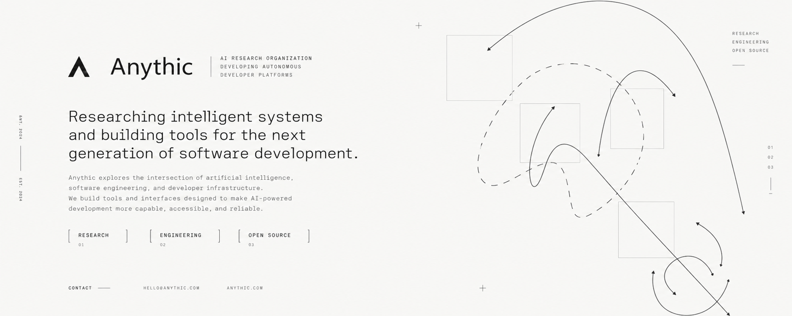

 

**AI research organization. Developing autonomous developer platforms.**

Researching intelligent systems. Engineering tools for developers.

 &nbsp;·&nbsp; [Open Source](https://github.com/anythic/anythic-ui) &nbsp;·&nbsp; [npm](https://www.npmjs.com/package/@anythic/ui)

---

### 01 / About Anythic

Anythic explores the intersection of artificial intelligence, software engineering, and developer infrastructure. Our focus is on practical systems that make AI-assisted development more capable, reliable, and accessible.

We research autonomous workflows and build tools that help developers work with intelligent systems—from streamed interfaces to agent execution environments.

### 02 / Research & engineering

| Focus | What we explore |
| :--- | :--- |
| **Autonomous Development** | Agent workflows for planning, coding, tool use, and execution. |
| **Developer Infrastructure** | Foundations and interfaces for AI-powered software. |
| **Open Source** | Reusable components and tools for the wider developer ecosystem. |

### 03 / Featured open source

#### [anythic/ui](https://github.com/anythic/anythic-ui)

**Composable React components for AI interfaces.**

Build streaming conversations and agent experiences with reasoning blocks, tool calls, approvals, plans, code diffs, and terminals. Works with any model or backend.

**React** · **TypeScript** · **Tailwind CSS v4**

[Explore the repository](https://github.com/anythic/anythic-ui) · [Install from npm](https://www.npmjs.com/package/@anythic/ui) · [Contribution guide](https://github.com/anythic/anythic-ui/blob/main/CONTRIBUTING.md)

### 04 / Connect

For projects, research, and open-source collaboration:

 · [GitHub](https://github.com/anythic)

---

ANYTHIC / RESEARCH · ENGINEERING · OPEN SOURCE

